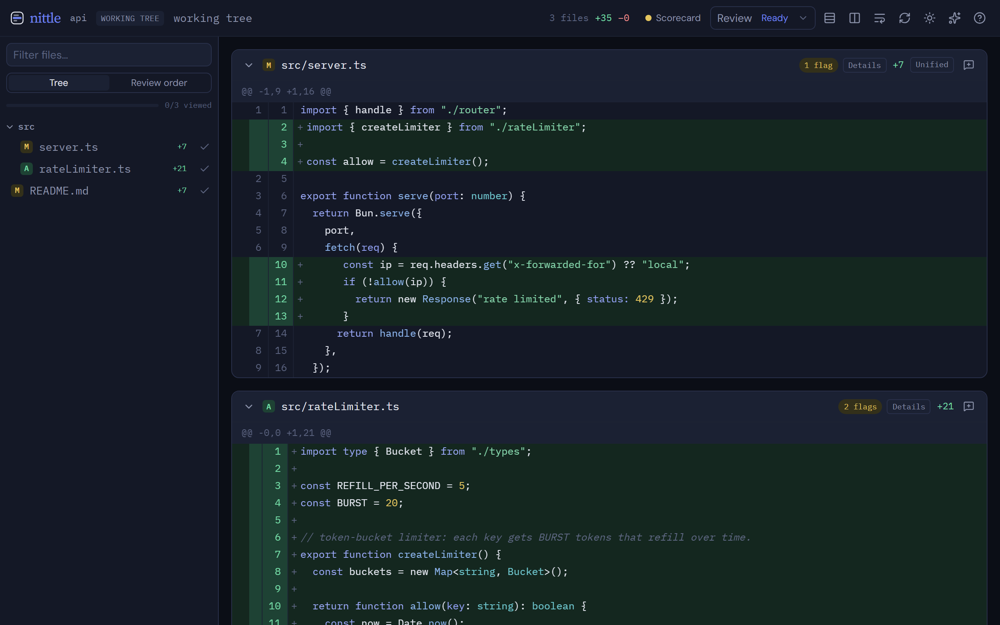
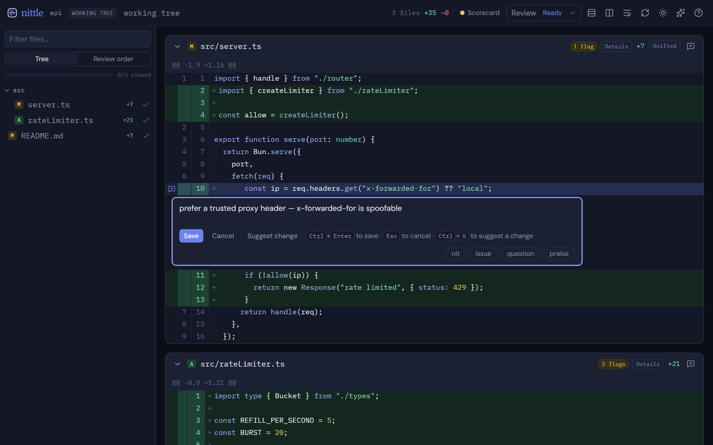
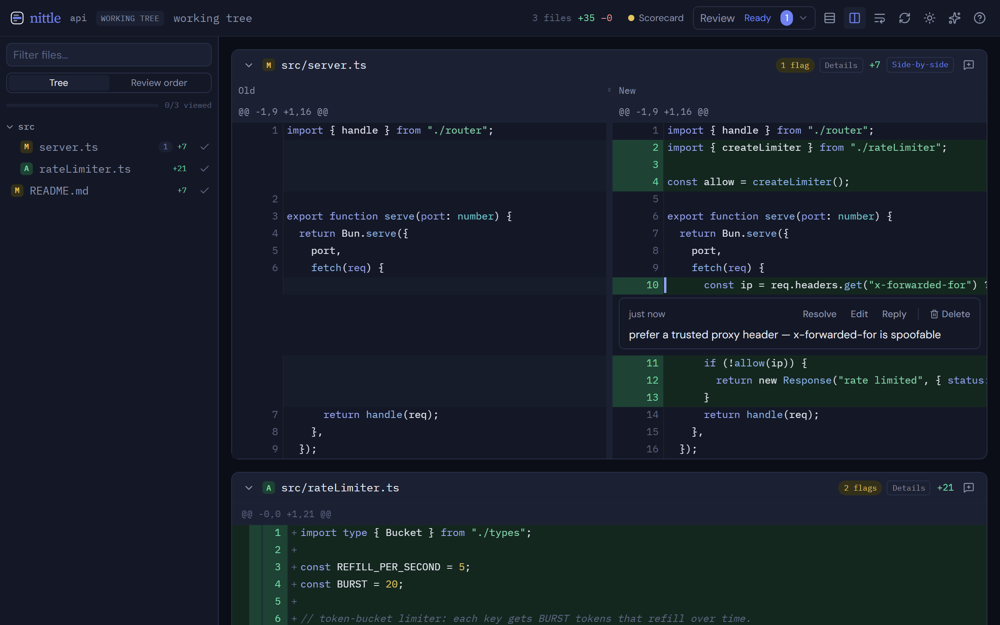
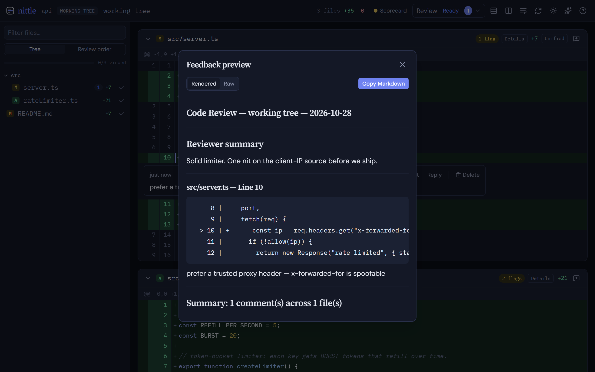

# nittle

[](https://github.com/codywilliamson/diffle/actions/workflows/ci.yml) [](https://github.com/codywilliamson/diffle/releases/latest) [](LICENSE) [](https://nittle.dev)

Local git diff viewer for focused code review. Leave inline comments on any line, then return structured feedback to an agent or copy it manually.

nittle, fka diffle (the Deterministic Inspection & Feedback Framework for Language-model Engineering, per ADR 0004, which we stand by), fka loupe.

**Site & docs: [nittle.dev](https://nittle.dev)**

Want to help? Read the [contribution guide](CONTRIBUTING.md). Please [report security issues privately](SECURITY.md).

## Demo


Review a diff, comment on exact lines, and export structured feedback for your agent. [Watch the MP4](docs/screenshots/walkthrough.mp4) or read the [docs](https://nittle.dev).

Side-by-side diffs have independent horizontal scrolling and a resizable divider. Line numbers and comments stay visible, and wrapped lines stay aligned across both sides. [Reviewing changes](https://nittle.dev/guides/reviewing-changes/) covers the pointer and keyboard controls.

## Screenshots



| Inline comment | Side-by-side | Structured feedback |
| --- | --- | --- |
|  |  |  |

## Install

nittle ships as a single self-contained binary — no checkout, no Node, no sidecar files. It needs only **`git`** on your `PATH`.

```sh
# macOS / Linux
curl -fsSL https://nittle.dev/install | sh
```

```powershell
# Windows
irm https://nittle.dev/install.ps1 | iex
```

The installer downloads the binary for your OS/arch, verifies its SHA-256 against the published checksums, and installs it to `~/.nittle/bin`. On macOS and Linux it also adds that directory to your login shell's rc file inside a `# >>> nittle >>>` marker block — run `exec $SHELL -l` to use it in the current shell, opt out with `NITTLE_NO_MODIFY_PATH=1`, or undo it with `curl -fsSL https://nittle.dev/install | NITTLE_UNINSTALL=1 sh`. On a terminal, the installer then offers to run `nittle setup` to wire nittle into your coding agents (skip with `NITTLE_NO_SETUP=1`). Keep it current with `nittle update`. Full instructions — custom locations, uninstall, building from source — are in the [installation guide](https://nittle.dev/getting-started/installation/).

## Usage

```sh
nittle                  # working tree vs HEAD (untracked included)
nittle staged           # staged changes only
nittle <branch>         # current branch vs named branch (PR-style)
nittle <ref1>..<ref2>   # commit range
nittle browse           # review the whole codebase
nittle browse src/      # scope to a subtree
nittle mcp serve        # local MCP server for agent integrations
nittle mcp list         # list running MCP servers
nittle mcp restart      # stop MCP servers so agents relaunch them (e.g. after an update)
nittle setup            # wire nittle into your coding agents (--remove to undo)
nittle sessions         # list running nittle sessions
nittle cleanup          # stop stale sessions and finished reviews
nittle update           # self-update to the latest release
nittle update --check   # only report whether a newer release exists
nittle --license         # print the bundled MIT license notice
nittle doctor           # check the Claude Code plugin install (--fix to repair)
```

Flags: `-p, --port <n>` fixed port, `--no-open` don't launch the browser, `--review-id <id>` reopen a record, `-v, --version`, `--license`, `-h, --help`. `cleanup` accepts `--yes` to skip its confirmation and `--all` to also stop active sessions. `doctor` accepts `--fix` to run the repair commands and `--yes` to skip its confirmation. `mcp restart` accepts `--yes`. `setup` accepts `--remove`, `--agents <id,id>`, and `--yes`. Run `nittle <command> --help` for a command's options and examples. `nittle update` finishes by listing the next steps that apply (restart open reviews, reconnect agents, `nittle mcp restart`).

nittle reviews whichever git repo you run it from, then prints a `http://localhost:<port>` URL and opens it in your browser — the diff renders there, not in the terminal.

## Review scorecard

The **Scorecard** (`g`) summarizes a diff before you read it: size, test coverage, public API, dependencies, hotspots, and risk flags. Each category is Low, Medium, or High from fixed rules, not AI. **Review order** (`m`) groups files by project, with dependencies first and each source file before its test. See [the review scorecard guide](https://nittle.dev/guides/review-scorecard/).

## Keyboard shortcuts

Press `?` in the UI for this list at any time.

| key | action |
| --- | --- |
| `j` / `k` | next / previous file |
| `v` | toggle viewed on the current file |
| `s` | unified ↔ side-by-side (added and deleted files stay unified) |
| `w` | wrap long lines |
| `g` | open the review scorecard |
| `m` | file list: tree ↔ review order |
| `o` | single-file ↔ all-files view |
| `t` | toggle light / dark mode |
| `r` | re-run the diff |
| `c` | preview review feedback |
| `?` | show the shortcut overlay |
| `Ctrl`/`⌘` + `Enter` | save the open comment |
| `Esc` | close dialogs, cancel an open comment |

To comment on a range, drag across the line numbers or shift-click a second line.

## Review with an agent

1. Ask Codex or Claude Code: `Review my current changes with nittle.`
2. Leave line- or file-level comments in nittle and choose **Return Feedback**.
3. Return to the agent and say `continue`.
4. Agent replies and rereview requests appear in nittle as they happen; choose **Refresh diff** from the notice to load the new changes.
5. Verify the changes, reply in a thread or resolve it, then approve or return more feedback. Asking the agent for more after approval reopens the same review.

Install the agent integration first — see [Agent integrations](#agent-integrations).

## Review records

Reviews are stored outside the repository under `~/.nittle/reviews/<review-id>/review.json`. Each
record keeps its Git comparison, comments, replies, addressed/resolved state, summary, and outcome.
Approved and cancelled reviews remain local until explicitly deleted.

**Resolve** a comment to keep it on the record but drop it from returned feedback and open-comment counts — reopen it any time.

When the code moves on and a comment's line or file leaves the current diff, it becomes **orphaned** — still saved, but no longer anchored anywhere in the view. **Preview Feedback** gathers these under **From earlier reviews**, where you can resolve or delete each one, and keeps them out of current feedback.

Markdown files open showing their diff; use the per-file **Preview** toggle to render them.

## Agent integrations

nittle ships explicit review skills for Codex and Claude Code that drive a review through the local MCP server, and can register the MCP server with Cursor, Gemini CLI, VS Code, Windsurf, OpenCode, Zed, and GitHub Copilot CLI. All need the `nittle` command from [Install](#install) on your `PATH`.

The quickest route is `nittle setup`: it detects your installed agents, lets you pick which to wire up, shows exactly what it will run or write, and asks before applying. It's idempotent, and `nittle setup --remove` undoes it. Pass `--agents claude,codex` to skip the picker and `--yes` to skip the confirmation.

```sh
nittle setup
```

Or install the plugins by hand:

```sh
# Claude Code
claude plugin marketplace add codywilliamson/diffle
claude plugin install nittle-review@nittle-local --scope user

# Codex
codex plugin marketplace add codywilliamson/diffle
codex plugin add nittle-review@nittle-local
```

Start a fresh agent session afterwards (or run `/reload-plugins` in Claude Code), then ask
`Review my current changes with nittle.` The plugin is named `nittle-review`. Package sources and
maintenance notes live in [`integrations/`](integrations/README.md); see the [agent feedback guide](https://nittle.dev/guides/agent-feedback/) for the full loop.

## Upgrading from diffle

nittle was called diffle until 2026-10-17 (see [ADR 0008](docs/adr/0008-rename-diffle-to-nittle.md)). There is no `diffle` alias. Run `diffle update` once on a 0.28.x install and it lands on nittle. The first nittle run then moves `~/.diffle` to `~/.nittle`, moves the install dir, fixes your PATH entry, rewires agent plugins and MCP configs, and removes the old diffle files. Review records are moved, never deleted before they are confirmed at the new location. `DIFFLE_*` environment variables are still read as a fallback, and nittle prints a one-time note saying which to rename. Your shell profile is not edited.

The repo stays at `codywilliamson/diffle` until the GitHub rename. Old URLs keep redirecting afterwards.

## Releases

See [CHANGELOG.md](CHANGELOG.md).
